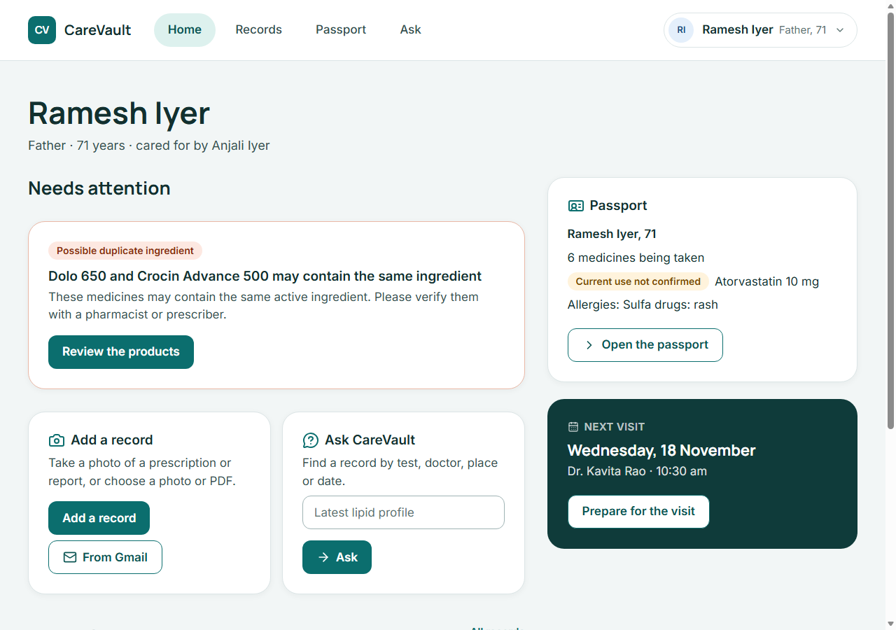
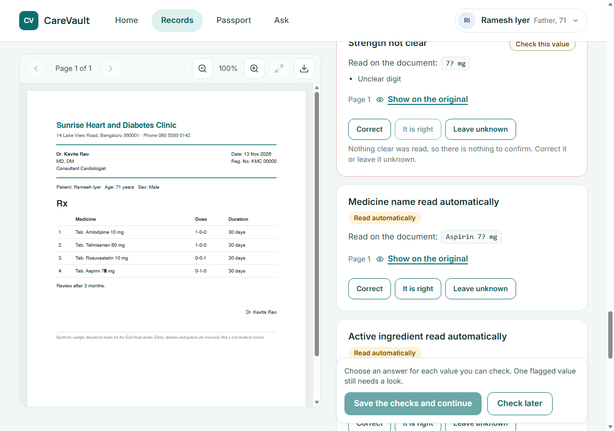
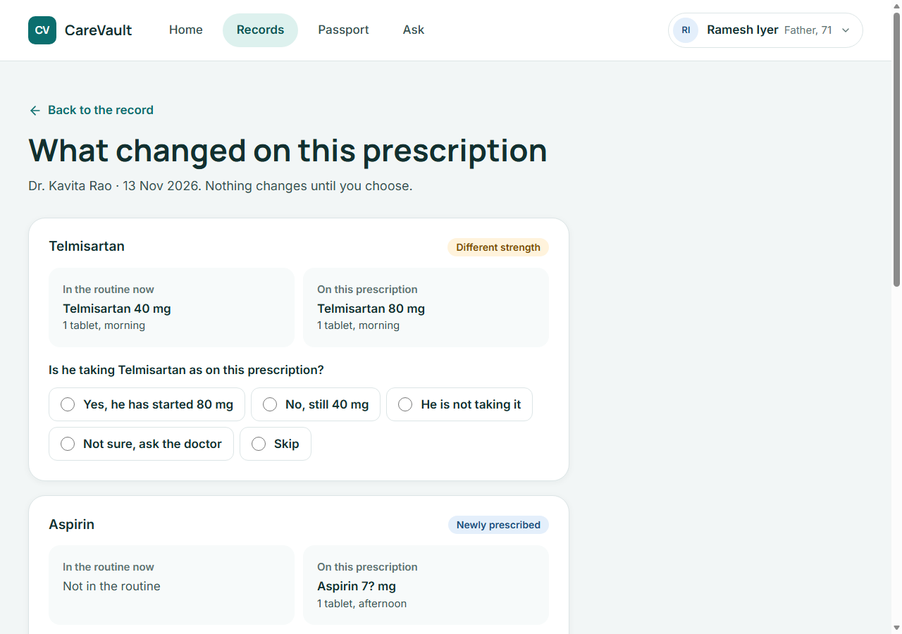
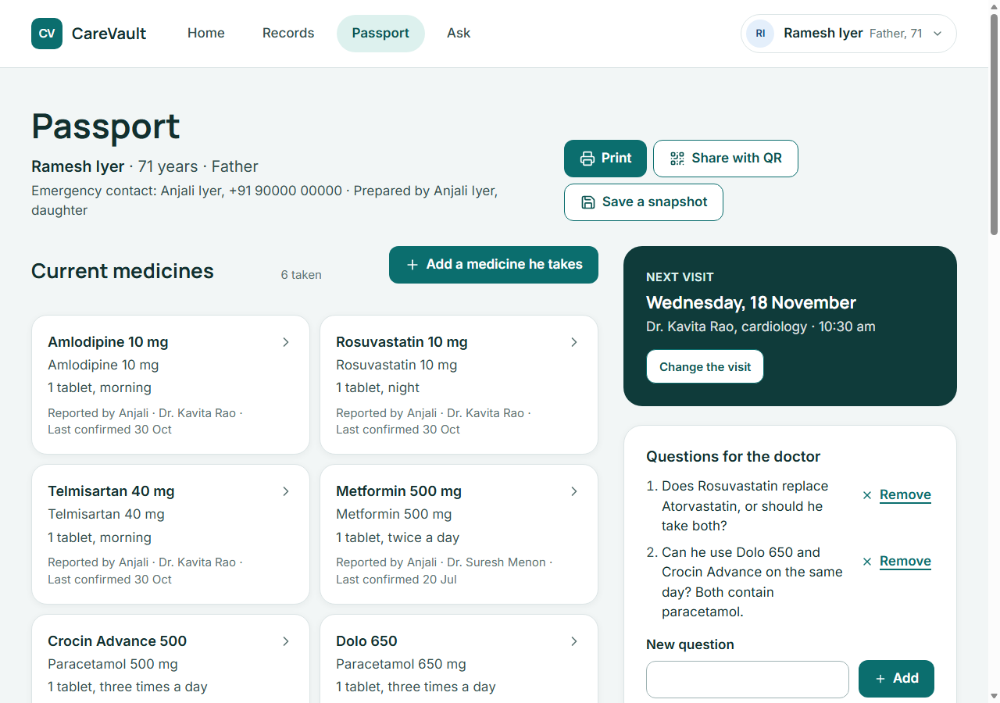
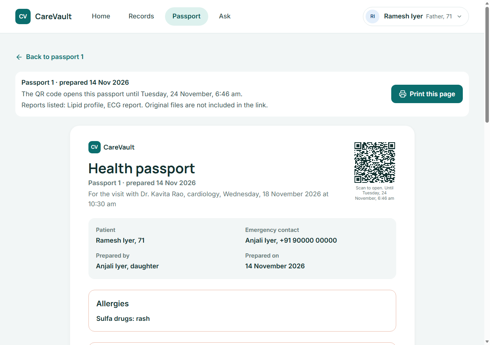
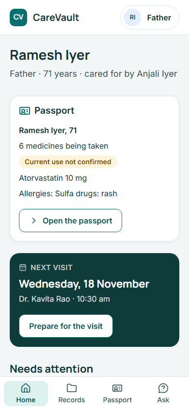
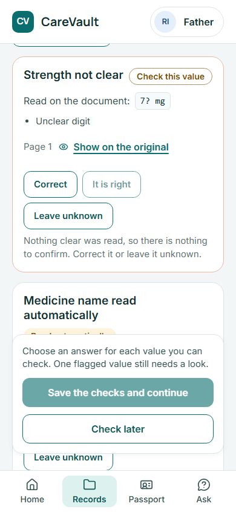
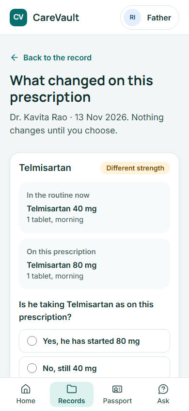

# CareVault

**A family health passport.** A patient, or a caregiver acting for one, keeps medical records, the medicines the patient actually takes, and what a doctor needs at a visit, in one place on their own device.

> **Not medical advice. Synthetic data only.** CareVault lists what was entered and confirmed. It never diagnoses, never recommends a treatment and never tells anyone to start or stop a medicine. Where it flags something it says "possible" and asks you to check with a pharmacist or the prescriber. Every person, doctor, clinic and document in the sample data is invented.

Built for GenHacks 2026 (Healthcare & Environmental track).

## What CareVault v2 does

```
Collect a record → read it on the device → you check what matters
   → file it (records, timeline, search)
   → if it is a prescription: see what differs from the current routine
   → you decide what actually changed → the routine updates
   → before a visit: freeze a passport snapshot → print it or share it by QR
```

- **One way to add a record:** a photo, a PDF, or a report from Gmail. The original is saved first, so nothing is lost if reading fails; then it is read on the device, with "Read 2 of 5 pages" when only part of it could be read.
- **Check the values.** A value that could not be read clearly ("7? mg") is shown beside the original, with the literal text read and why it was flagged. You correct it, confirm it, leave it unknown, or retake the photo. Nothing unchecked ever reaches the routine.
- **Review changes, in context.** A new prescription is compared with the medicines actually taken, not with the previous prescription. Each difference is one question ("Is he taking Telmisartan as on this prescription?"). A medicine missing from the prescription is asked about; it is never stopped on its own. Nothing changes until you choose, and every change can be undone.
- **The passport.** Current medicines with where each came from and when it was last confirmed, entries whose use is not confirmed, allergies (listed, none known, or not recorded), conditions, possible duplicate ingredients, questions for the doctor and the reports to share.
- **Snapshots, print and share.** Printing or sharing always freezes a numbered snapshot. A printed QR code only ever opens that exact snapshot, and a later edit or a deleted record never changes a snapshot already made.
- **Find things.** Search by test, doctor, place and date, or ask in plain words ("latest lipid profile"). Answers come from fixed rules over your records; there is no language model.
- **Several people.** Each profile is separate: records, routine, passports and share links never cross.

## The first release story

This is the walk-through that shows v2 works. It runs on a phone-sized screen against the built-in sample data (see below).

1. **Save a new prescription with an unreadable strength.** Add `rx-rao-2026-11-13.pdf`, Dr. Rao's prescription of 13 November 2026. The Aspirin strength reads "7? mg" and is flagged.
2. **Check it against the original and correct it** to 75 mg in Check the values. The prescription now reads "Aspirin 75 mg".
3. **Review what it changes.** CareVault asks about Telmisartan (40 mg in the routine, 80 mg on the prescription), Aspirin (new) and Atorvastatin (not on this prescription). Answer "Yes, he has started 80 mg" for Telmisartan and Skip the other two. The summary says "Telmisartan updated to 80 mg. Aspirin unchanged. Atorvastatin unchanged." Only Telmisartan changes, and nothing about the skipped questions appears on Home.
4. **Find the latest lipid profile** by searching Records for "lipid profile", or by asking "latest lipid profile": 12 Nov 2026, Lakeside Diagnostics.
5. **Prepare the passport.** Share with QR, then "Print with this QR code". The printed page and the page the QR opens show the same passport: the same patient, number and date.
6. **Nothing breaks it.** Switch to the second profile: none of Ramesh's data or links appear. Mark a medicine as stopped: the earlier snapshot reads exactly as before. Save a backup and restore it: the snapshot and its link still open as before.

## Screens

| Home | Records |
| --- | --- |
|  |  |

| Check the values | Review changes |
| --- | --- |
|  |  |

| Passport | Print with QR |
| --- | --- |
|  |  |

| On a phone: Home | On a phone: Check the values | On a phone: Review changes |
| --- | --- | --- |
|  |  |  |

Every screen, at desktop and phone size, is in [docs/screenshots/](docs/screenshots/): Welcome, Home, Records (grid, timeline, search), a record, Add a record, Check the values, Review changes, Passport, a medicine, the share dialog, a snapshot, Print, the shared page, Ask and Settings.

## Privacy by design

Records live **only in the browser on your device** (IndexedDB). There is no account and no cloud database of records.

They leave the device in exactly three cases, each behind an explicit action and announced while it happens:

| When | What leaves the device | Safeguards |
| --- | --- | --- |
| **Cloud reading of one page** | That one page, only when it was too hard to read on the device | Off by default: you are asked each time. It can be set to "send without asking" in Settings; a notice still shows on every send. The server forwards the page to the reader and stores nothing. Every value read is still checked by you. |
| **Gmail import** | Read-only requests from this browser to Google's Gmail API, returning the report PDFs you choose | Read-only access for this session only. The token stays in the browser's memory. Nothing passes through CareVault's server. |
| **Sharing a passport** | One passport snapshot, **encrypted on the device first** (AES-GCM) | The key is only in the link after `#`, which browsers never send to a server. The server stores ciphertext it cannot read. Links expire after 2, 8 or 24 hours and can be revoked. |

Backups are one file encrypted with your passphrase. Backups made with earlier versions can still be restored.

## Run it locally

You need Node.js 22.12 or later.

```bash
npm ci
cp .env.example .env
```

**Explore it on the sample data (no server, no keys):** keep `VITE_USE_MOCK=true` in `.env`, then

```bash
npm run dev
```

open the address it prints (http://localhost:5173) and choose **Try the sample profiles**. The mock services keep everything in memory, so a page reload starts again from the sample data.

**The real app, storing data in your browser:** set `VITE_USE_MOCK=false`, then in two terminals

```bash
npm run dev:server   # the API on http://localhost:8787
npm run dev          # the app; /api is proxied to the server
```

The app works without any keys. Cloud reading, sharing and Gmail import need their settings in `.env` (`GEMINI_API_KEY`, `GEMINI_MODEL`, `SUPABASE_URL`, `SUPABASE_SERVICE_ROLE_KEY`, `VITE_GOOGLE_CLIENT_ID`). Without them those three features say they are not set up, and everything else keeps working. Never commit a real `.env`.

**Production build:** `npm run build`, then `npm start` serves the app and the API on `PORT` (default 8787).

**Checks:** `npm run check` runs the typecheck, every test and the production build. `npm run lint` runs ESLint.

## The sample data

**Try the sample profiles** loads two invented people. The sample calendar is fixed on Saturday 14 November 2026, so the demo always reads the same.

- **Ramesh Iyer** (father, 71), cared for by his daughter Anjali:
  - doctors Dr. Kavita Rao (cardiology) and Dr. Suresh Menon (diabetology);
  - three prescriptions, a lipid profile, an ECG report, and an HbA1c report from email with no date on it, waiting to be filed;
  - a routine of six medicines taken, Atorvastatin 10 mg whose use is not confirmed, and two paracetamol products (Dolo 650 and Crocin Advance 500, 3,450 mg a day if both are taken as entered);
  - an allergy to sulfa drugs;
  - a visit with Dr. Rao on Wednesday 18 November 2026 at 10:30 am, with two questions ready.
- **Lakshmi Iyer** (mother, 68): one thyroid report, Levothyroxine 50 mcg, no known allergies. She is there to show that nothing crosses between profiles.

The documents are synthetic PDFs in `public/sample-docs/`.

## Tech stack

| Layer | Choice |
| --- | --- |
| App | Vite, React, TypeScript, React Router, Tailwind CSS, Motion, lucide-react, installable PWA |
| Local records | Dexie over IndexedDB |
| Rules | Pure TypeScript, tested with Vitest: matching, totals, review proposals and the verification gate are deterministic, never model output |
| Reading on the device | pdf.js for text PDFs, OCR for photos, a bundled drug reference |
| Cloud reading | Gemini with JSON-schema output, called only from the server, only with consent |
| Sharing | Web Crypto AES-GCM, `qrcode`, one Supabase table holding ciphertext |
| Server | Node with Hono |

The UI talks to one interface, `CareVaultServices` (`src/contract/services.ts`). The real implementation is in `src/core`; an in-memory mock with the same behaviour is in `src/ui/mock/v2`.

## Project layout

```
src/contract/   the interface both sides build against, and the sample case
src/core/       database, rules, reading, sharing, Gmail, backup
src/ui/         screens, components, hooks, mock services
server/         Hono server: cloud reading and the share store
docs/specs/     the build specification
docs/screenshots/  every screen at desktop and phone size
```
