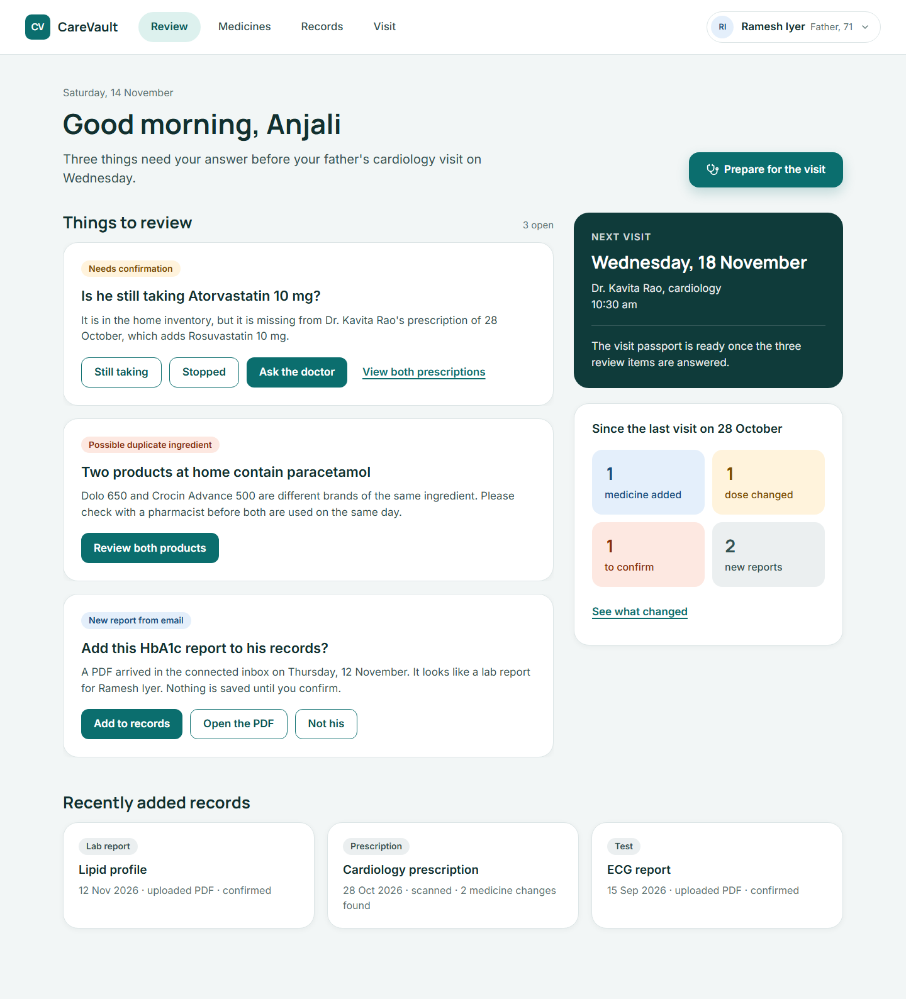
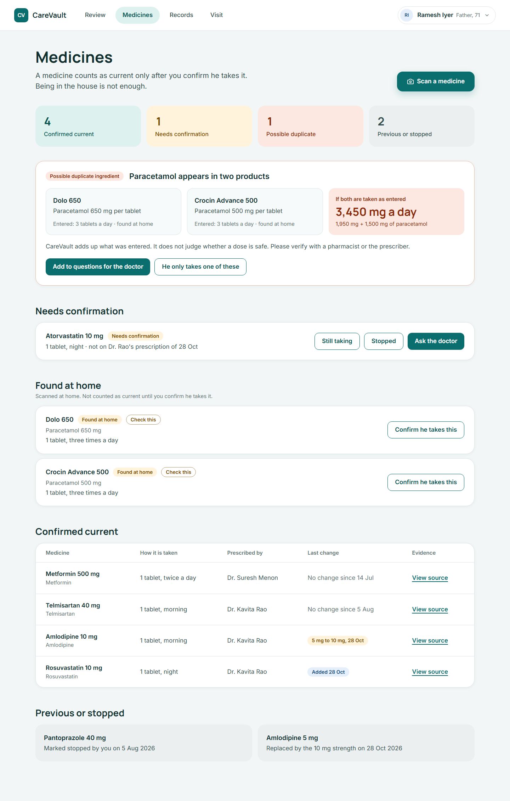
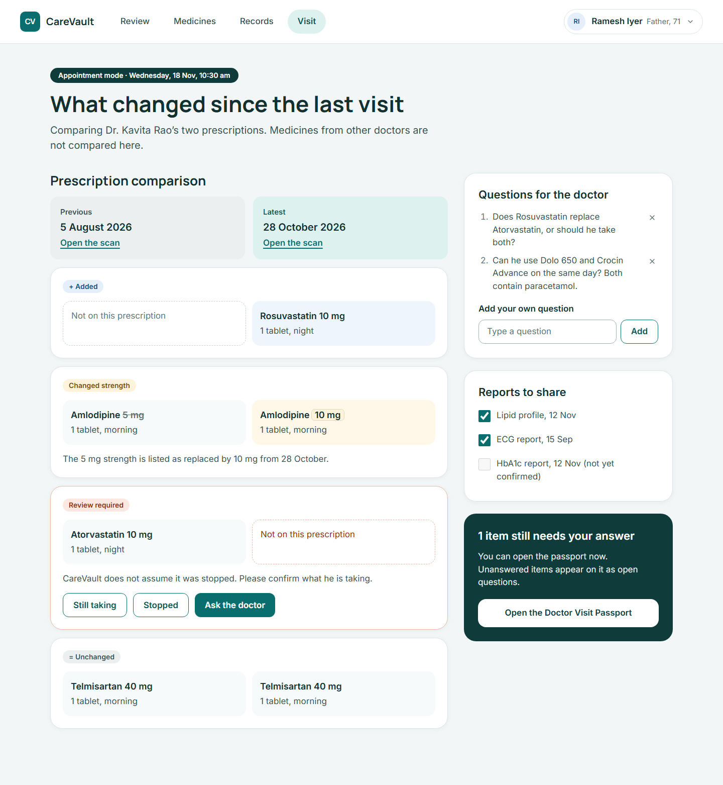
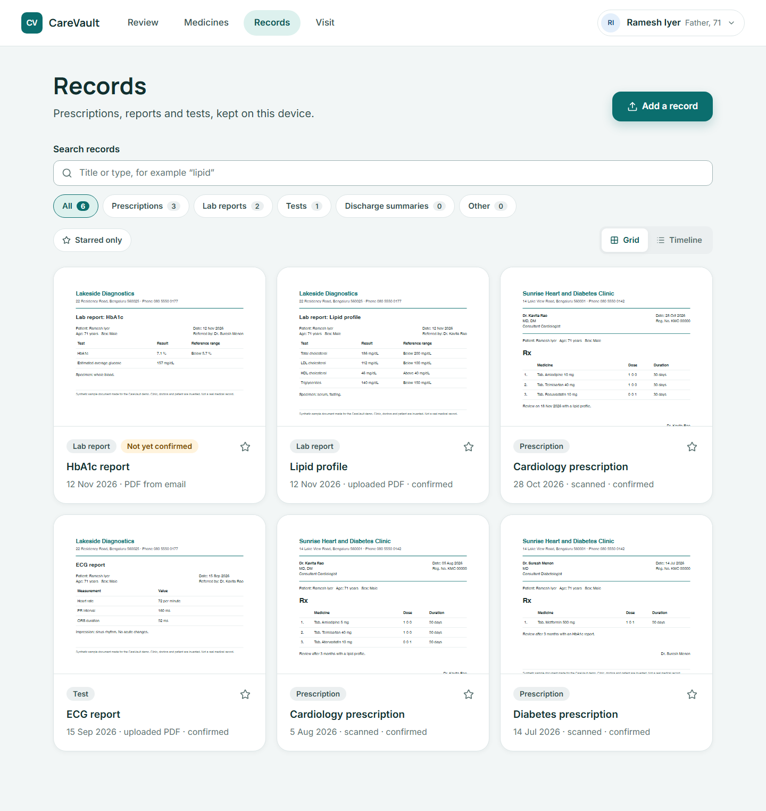
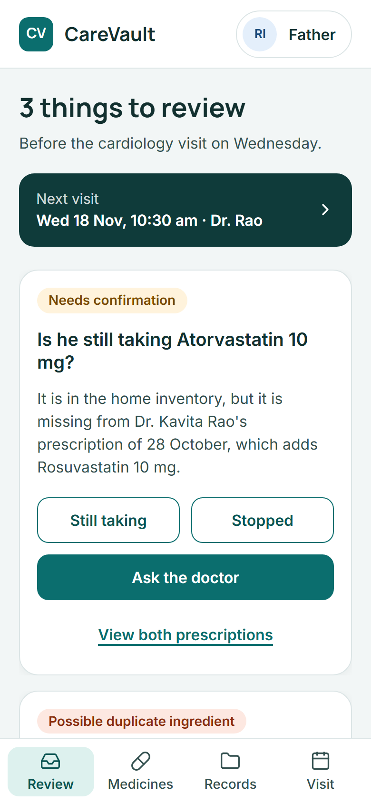

# CareVault

**A family health passport.** CareVault helps an adult child who looks after an older parent keep track of that parent's medicines and medical records, and arrive at every doctor visit prepared.

It answers four questions:

1. What medicines is my parent taking right now?
2. What changed after the last doctor visit?
3. Do two products at home contain the same active ingredient?
4. What should we take to the next appointment?

> **Not medical advice. Synthetic data only.** CareVault lists and adds up what the caregiver entered and confirmed. It never diagnoses, never recommends a treatment and never tells anyone to start or stop a medicine. Wherever it flags something, it says "possible" and asks you to check with a pharmacist or the prescriber. Every person, doctor, clinic and document in the sample profile is invented.

Built for GenHacks 2026 (Healthcare & Environmental track).

## How it works

```
Scan medicines at home -> caregiver confirms -> current medication list
        -> doctor visit -> scan the new prescription -> compare with the last one
        -> review items -> caregiver answers -> updated passport -> next visit
```

- **Scan a medicine pack** with the phone camera. The photo is read on the device, and every field is marked "Check this" until you confirm it. The photo is kept beside the record.
- **Spot duplicate ingredients.** When two products contain the same ingredient (Dolo 650 and Crocin Advance 500 both contain paracetamol), CareVault shows both and adds up what was entered: 1,950 mg + 1,500 mg = 3,450 mg a day. It does not judge whether that is safe.
- **Compare prescriptions.** Upload a new prescription and CareVault compares it with the previous one from the same doctor: added, changed, unchanged, and anything missing. A medicine missing from the new prescription becomes a question, never an automatic "stopped".
- **Answer review items** in one inbox, with Undo.
- **Prepare the visit.** Collect questions for the doctor, choose the reports to share, and open the Doctor Visit Passport: one A4 page you can print, save as PDF or share with a QR code.

## Screens

| Review (home) | Medicines |
| --- | --- |
|  |  |

| What changed since the last visit | Doctor Visit Passport |
| --- | --- |
|  |  |

| Records | On a phone |
| --- | --- |
|  |  |

## Privacy by design

The health record lives **only in the browser on your phone** (IndexedDB). There is no account and no cloud database of records.

It leaves the phone in exactly three cases, each behind an explicit action, and each announced by a notice while it happens:

| When | What leaves the phone | Safeguards |
| --- | --- | --- |
| **Cloud reading of one photo** | That one photo, only when it was too hard to read on the device | Off by default: you are asked each time ("Send this photo"). It can be switched to "send without asking" in Settings; a notice still shows on every send. The server forwards the image to the reader and stores nothing. |
| **Gmail import** | Read-only requests from this browser to Google's Gmail API, which return the report PDFs you choose | Access is read-only (`gmail.readonly`) and lasts for this session only. The access token stays in the browser's memory. Nothing passes through CareVault's server. |
| **Sharing a passport** | The passport, **encrypted on the phone first** (AES-GCM) | The key is only in the link after `#`, which browsers never send to the server. The server stores ciphertext it cannot read. Links expire after 2, 8 or 24 hours and can be revoked. |

Backups are a single file encrypted with your passphrase (PBKDF2 + AES-GCM). You keep it wherever you like.

## Tech stack

| Layer | Choice |
| --- | --- |
| App | Vite, React, TypeScript, React Router, Tailwind CSS, Motion, lucide-react, installable PWA (vite-plugin-pwa) |
| Fonts | Manrope and Inter, self-hosted with @fontsource |
| Local records | Dexie over IndexedDB |
| Rules engine | Pure TypeScript with Vitest: totals, comparison and status changes are deterministic and tested, never model output |
| Reading on the device | Tesseract.js (PaddleOCR.js as fallback) for photos, pdf.js for text PDFs, a bundled drug reference |
| Cloud reading | Gemini API with JSON-schema output, called only from the server |
| Sharing | Web Crypto AES-GCM, `qrcode`, one Supabase table holding ciphertext |
| Server | Node with Hono: `/api/extract`, `/api/share`, `/api/health`, and the built app |
| Validation | zod for everything that crosses a boundary |

The UI talks to one interface, `CareVaultServices` (`src/contract/services.ts`). The real implementation is in `src/core`; an in-memory mock with the same behaviour lives in `src/ui/mock`, so the interface can be explored without a server.

## Run it locally

You need Node.js 22.12 or later.

```bash
npm ci
cp .env.example .env
```

**Just the app, on the built-in sample data (no server, no keys):** set `VITE_USE_MOCK=true` in `.env`, then

```bash
npm run dev
```

and open the address it prints (http://localhost:5173).

**The real app, storing data in your browser:** set `VITE_USE_MOCK=false` in `.env`, then in two terminals

```bash
npm run dev:server   # the API on http://localhost:8787
npm run dev          # the app; /api is proxied to the server
```

The app works without any keys. Cloud reading, sharing and Gmail import need their settings in `.env` (`GEMINI_API_KEY`, `GEMINI_MODEL`, `SUPABASE_URL`, `SUPABASE_SERVICE_ROLE_KEY`, `VITE_GOOGLE_CLIENT_ID`). Without them, those three features say they are not set up and everything else keeps working. The setup steps for each service are in [docs/progress-core.md](docs/progress-core.md).

**Production build:** `npm run build`, then `npm start` serves the app and the API on `PORT` (default 8787).

**Checks:** `npm run check` runs the typecheck, every test and the production build.

## The sample profile

On the first screen, choose **Try the sample profile**. It loads Ramesh Iyer (father, 71), cared for by his daughter Anjali, with:

- two doctors: Dr. Kavita Rao (cardiology) and Dr. Suresh Menon (diabetology);
- three prescriptions, the latest from Dr. Rao on 28 October 2026, which raises Amlodipine from 5 to 10 mg, adds Rosuvastatin and leaves out Atorvastatin;
- two paracetamol products found at home (3,450 mg a day if both are taken as entered);
- six documents, including an HbA1c report waiting in the inbox from email;
- a visit with Dr. Rao on Wednesday 18 November 2026, 10:30 am, with two questions ready.

The sample case is set on Saturday 14 November 2026, and its calendar stays on that day so the demo always works. All of it is invented; the six documents are synthetic PDFs in `public/sample-docs/`.

## Project layout

```
src/contract/   the interface both sides build against, and the sample case
src/core/       database, rules engine, reading, sharing, Gmail, backup
src/ui/         screens, components, hooks, mock services
server/         Hono server: cloud reading and the share store
docs/specs/     the build specification
docs/design/    the design mockups
```
